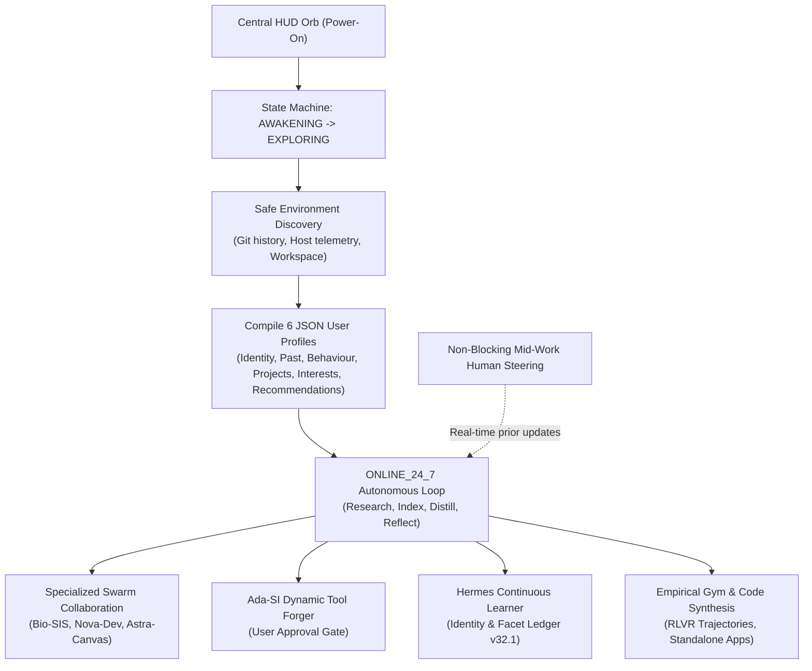
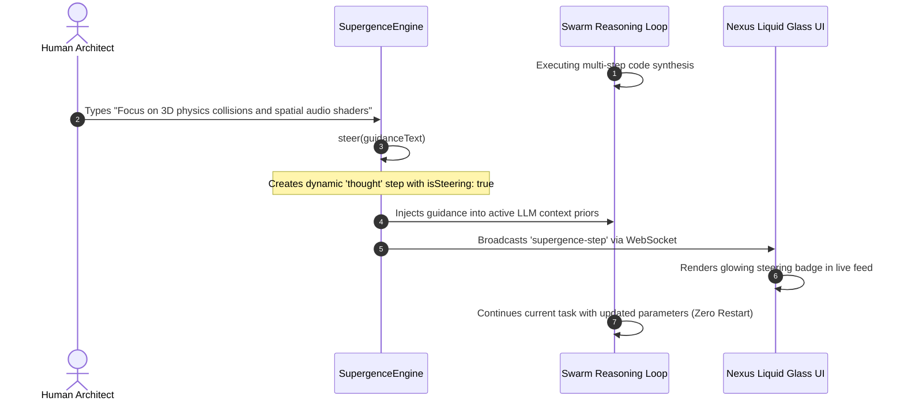
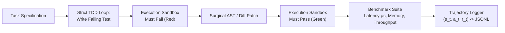

# How Supergence Works: Architecture, Mechanics, and 24/7 Co-Creation Engine

> **System:** Super Intelligent System 1.0 (SIS 1.0) / Supergence  
> **Target Scope:** End-to-end technical explanation of Supergence architecture, autonomous lifecycle, multi-agent swarms, empirical verification, and live co-creation.

---

## 1. Executive Overview

**Supergence** is the autonomous 24/7 background co-creation operating system and multi-agent superintelligence core within SIS 1.0. Rather than operating as an ephemeral chatbot that waits passively for user prompts, Supergence functions as a **persistent, self-driven cognitive collaborator**.



### Key Differences from Traditional AI Agents

1. **Continuous Autonomy:** Operates 24/7 in an asynchronous background loop without stalling when idle.
2. **Deep Grounded Personalization:** Autonomously constructs and persists 6 structured user and project profiles by safely indexing machine and workspace state.
3. **Non-Blocking Mid-Work Steering:** Users can guide ongoing tasks mid-execution without aborting, resetting, or blocking the execution pipeline.
4. **Specialized Multi-Agent Swarm:** Coordinates dedicated domain leads for biology, systems programming, spatial WebGL design, tool forging, and lifelong learning.
5. **Empirical Ground Truth Verification:** Avoids hallucinated self-evaluations by running deterministic benchmarks, measuring CPU/memory latency, and recording verifiable reward trajectories ($\tau$).

---

## 2. Core Lifecycle and State Machine

The heartbeat of Supergence is managed by the [`SupergenceEngine`](../../server/orchestrator/supergence-engine.js) singleton. It transitions through four discrete states:

```
[STANDBY] ──► [AWAKENING] ──► [EXPLORING] ──► [ONLINE_24_7] ──► [BUILDING]
```

### The States

- **`STANDBY`**: The engine is dormant, awaiting the ignition signal from the client HUD or API.
- **`AWAKENING`**: Triggered via `POST /api/supergence/power-on` or WebSocket event `supergence-power-on`. Memory structures and broadcast channels initialize.
- **`EXPLORING`**: The engine runs an automated, non-destructive sweep of host telemetry, git commit history, communication records, and repository manifests to compile cognitive profiles.
- **`ONLINE_24_7`**: The exploration phase completes. The background co-creation loop engages indefinitely on a 35-second cadence, continuously surveying workspace changes, researching shader/code patterns, and updating system knowledge.
- **`BUILDING`**: Engaged when the user or background scheduler initiates project code generation. Supergence writes zero-stub, interactive applications to [`workspace/`](../../workspace).

---

## 3. Autonomous Environmental Exploration & Profile Compilation

When powered on, Supergence gathers situational awareness using deterministic local probes rather than hardcoded assumptions:

1. **Host Computer Telemetry:** Captures operating platform, CPU core counts, architecture, and available RAM (`os.userInfo()`, `os.cpus()`, `os.totalmem()`).
2. **Git Commit History & Attribution:** Queries `git log -n 5` inside the repository root to discover active authors, recent commit milestones, and architectural evolution.
3. **Workspace Indexing:** Reads the root and subdirectories to catalog active 3D scenes, shaders, neural modules, and orchestrator components.
4. **Cognitive Preference Synthesis:** Extracts interaction standards (e.g., Apple Liquid Glass design language, full-duplex audio, rejection of fake/canned numbers).

### The 6 Persistent JSON Profile Files

Supergence writes these discoveries directly into the [`data/`](../../data) directory:

| Profile File                      | Path                                      | Description & Purpose                                                                                       |
| :-------------------------------- | :---------------------------------------- | :---------------------------------------------------------------------------------------------------------- |
| **User Identity**                 | `data/user-identity.json`                 | Stores developer name, locale, timezone, system hardware specifications, and machine permissions.           |
| **User Past**                     | `data/user-past.json`                     | Chronological repository milestones, recent commit hashes, and architectural lineage.                       |
| **User Behaviour**                | `data/user-behaviour.json`                | Interaction cadence, UI/UX aesthetics, and preferred technical stacks (Three.js, WebSockets, ESM, Node.js). |
| **User Projects**                 | `data/user-projects.json`                 | Active modules (Holographic Core, POSSAP Intent Forecaster, RSI Engine, Chemistor).                         |
| **User Interests**                | `data/user-interests.json`                | Priority frontier research domains (autonomous swarms, spatial computing, thalamocortical dynamics).        |
| **Collaboration Recommendations** | `data/collaboration-recommendations.json` | 5 pre-formulated, high-impact co-creation project proposals ready for autonomous compilation.               |

---

## 4. 24/7 Autonomous Background Execution Loop

After exploration completes, Supergence activates `start247AutonomousLoop()`. Every 35 seconds, it executes an autonomous sub-cycle across four rotating activities:

1. **Workspace Scanning:** Indexes newly modified files, checking for broken dependencies, unused assets, and architectural consistency.
2. **Autonomous Research:** Curates modern WebGL GLSL shader techniques, algorithmic optimization patterns, and distributed multi-agent protocols.
3. **Memory Consolidation:** Distills short-term interaction logs into the persistent long-term knowledge graph.
4. **Cognitive Reflection:** Re-evaluates collaborative project readiness and updates recommendations.

> [!NOTE]
> **Resource Yielding:** If the user is actively typing, dictating, or sending commands (`brain.isProcessing === true`), the background loop immediately yields compute cycles to prevent UI latency or thread contention.

---

## 5. Non-Blocking Human Mid-Work Steering

Traditional AI workflows are blocking: if an agent begins generating an extensive solution, the human user must either wait or terminate the entire run. Supergence implements **Human-in-the-Loop Mid-Work Steering**:



The guidance text is converted into an active thought step in the execution history, broadcasts to the client WebSocket, and updates the active context vector. The ongoing job adapts to new requirements in real time without restarting.

---

## 6. The Supergence Nexus & The Specialized Agent Swarm

The interface for Supergence is the **Supergence Nexus** ([`client/scripts/spark-task-engine.js`](../../client/scripts/spark-task-engine.js)), an Apple Liquid Glass left-anchored workspace that merges chat, thoughts, tool execution, and code previews into a **single living stream** without fragmented tabs.

Under the hood, [`AgentTeamManager`](../../server/services/agentTeam.js) coordinates five specialized autonomous teammates:

```
┌─────────────────────────────────────────────────────────────┐
│                    SUPERGENCE NEXUS SWARM                   │
├──────────────┬──────────────┬──────────────┬────────────────┤
│   Bio-SIS    │   Nova-Dev   │ Astra-Canvas │     Ada-SI     │
│ Life Science │ Systems/Code │ Spatial 3D   │ Tool Forger    │
├──────────────┴──────────────┴──────────────┴────────────────┤
│                           Hermes                            │
│                 Lifelong Cognitive Learner                  │
└─────────────────────────────────────────────────────────────┘
```

### 1. Bio-SIS (Life Sciences & Biology Lead)

- **Domain:** Structural genomics, molecular design, and enzymatic pathways (OpenDots biology).
- **Function:** Analyzes CRISPR off-target risks, predicts peptide folding stability, and formulates computational tasks for Nova-Dev and Astra-Canvas.

### 2. Nova-Dev (Systems & Coding Lead)

- **Domain:** Distributed systems, robotics, Node.js/Python architectures, and algorithm design.
- **Function:** Implements full-stack backends, socket pipelines, data structures, and deterministic unit tests.

### 3. Astra-Canvas (Spatial 3D & Creative Design Lead)

- **Domain:** WebGL, Three.js, procedural geometry, GLSL fragment/vertex shaders, and Apple Liquid Glass design.
- **Function:** Constructs interactive 3D spatial scenes, particle matrices, and cinematic visual systems.

### 4. Ada-SI (Autonomous Dynamic Tool Forger)

Managed by [`AdaToolForger`](../../server/services/adaToolForger.js):

- **Missing Tool Detection:** When an agent attempts an action that lacks a local tool, Ada-SI synthesizes a complete tool definition (name, JSON schema, and executable JavaScript code).
- **Strict User Approval Gate:** Synthesized tools **cannot execute autonomously**. Ada-SI renders an inline proposal card directly inside the living stream with `APPROVE` and `REJECT` controls.
- **Hot-Registration:** Upon user approval, the tool compiles dynamically and registers into the runtime [`toolRegistry`](../../server/tools/registry.js) without server restarts.

### 5. Hermes (In-Chat / In-Task Continuous Learner)

Managed by [`HermesLearner`](../../server/services/hermesLearner.js):

- **Continuous Memory:** Tracks memory version (v32.1+) and synaptic updates in `data/hermes-learning-ledger.json`.
- **Facet Extraction:** Scans every turn of human dialogue to extract aesthetic tastes, coding habits, and architectural constraints.
- **Prompt Evolution:** Automatically injects learned user facets into the system prompts of all swarm agents.

---

## 7. Empirical Verification & Superhuman Coding Pipeline

Supergence solves the "self-evaluation trap" (where an LLM generates a flawed solution and falsely praises its own work) through the **Empirical Gym** ([`server/improvement/empirical-gym.js`](../../server/improvement/empirical-gym.js)) and trajectory harvesting:



### Deterministic Benchmarking

The Empirical Gym executes code in an isolated harness and extracts quantitative ground-truth metrics:

- **Execution Latency:** Microsecond ($\mu\text{s}$) and millisecond ($\text{ms}$) timers using `process.hrtime.bigint()`.
- **Memory Overhead:** Measures heap allocation deltas ($\Delta \text{Heap}$).
- **Throughput & Edge-Case Pass Rate:** Validates boundary conditions against invariant test suites.

### Trajectory Harvesting for RLVR & DPO

Every execution step logs a structured tuple into `data/trajectories/`:
$$\tau = (s_t, a_t, r_t, o_t)$$
Where:

- $s_t$: Current state (prompt, active file AST, compiler diagnostics).
- $a_t$: Agent action (diff patch, tool invocation, terminal query).
- $r_t$: Verifiable scalar reward ($1.0$ for exit code 0 and passing tests, $0.0$ for syntax/runtime errors).
- $o_t$: Compiler stdout, test runner logs, or runtime diagnostics.

Winning runs ($\tau_w$) and losing runs ($\tau_l$) are exported to `dpo_pairs.jsonl` to provide dataset pairs for Direct Preference Optimization (DPO).

---

## 8. Autonomous Co-Creation & Interactive Code Generation

When triggered through `POST /api/supergence/build` or the Nexus proposal cards, Supergence builds complete, runnable applications directly into [`workspace/`](../../workspace):

1. **3D Autonomous Multi-Agent Swarm (`workspace/swarm-sim.html`):**
   - 25 independent Boids flocking agents rendered in Three.js.
   - Dynamic cohesion, separation, alignment, and boundary repulsion vectors.
   - Live telemetry HUD displaying swarm cohesion percentage, velocity deltas, and consensus pulse.
2. **Volumetric Holographic Cockpit (`workspace/volumetric-cockpit.html`):**
   - Real-time GLSL animated energy geometry mapped to GPU/CPU metrics.
3. **Autonomous Code Sandbox (`workspace/code-sandbox.html`):**
   - Split-pane code editing and instant sandboxed `<iframe>` rendering.
4. **Binaural Neural Synthesizer (`workspace/audio-synth.html`):**
   - Web Audio API dual-oscillator soundscape generator generating carrier and binaural frequencies.
5. **POSSAP Predictive Workspace Anticipator (`workspace/possap-copilot.html`):**
   - Predictive timeline engine forecasting file modifications and developer intentions.

---

## 9. Apple Liquid Glass Interface Philosophy

Supergence adheres to a strict design aesthetic implemented across CSS and WebGL:

```
┌─────────────────────────────────────────────────────────────┐
│                 APPLE LIQUID GLASS SPECIFICATION            │
├──────────────────────┬──────────────────────────────────────┤
│ Surface Blur         │ backdrop-filter: blur(28px)          │
│ Saturation           │ backdrop-filter: saturate(200%)      │
│ Base Tint            │ rgba(61, 82, 76, 0.45) (Seaweed)     │
│ Primary Accent       │ #C6CD85 (Pistachio)                  │
│ Secondary Highlight  │ #9F7CEF (Lavender)                   │
│ Background Canvas    │ #0B0F10 (Dark Void)                  │
│ Border Rim Lighting  │ 1px solid rgba(244, 240, 224, 0.2)   │
│ Specular Edge High   │ 1px solid rgba(244, 240, 224, 0.4)   │
└──────────────────────┴──────────────────────────────────────┘
```

- **Zero Canned Values Rule:** Per project governance, no telemetry metrics, latency numbers, or log lines are randomly generated or simulated with `Math.random()`. All statistics reflect actual operating system metrics or verifiable code outcomes.
- **Unified Surface:** Chat messages, internal thoughts, tool approval cards, and agent discussions share a continuous living viewport.

---

## 10. File & Component Index

| Component               | Path                                                                                         | Core Responsibility                                                                                     |
| :---------------------- | :------------------------------------------------------------------------------------------- | :------------------------------------------------------------------------------------------------------ |
| **Engine Orchestrator** | [`server/orchestrator/supergence-engine.js`](../../server/orchestrator/supergence-engine.js) | Primary state machine, power ignition, 24/7 background loop, mid-work steering, and co-creation builds. |
| **Swarm Manager**       | [`server/services/agentTeam.js`](../../server/services/agentTeam.js)                         | Registry and autonomous collaborative dialogue for Bio-SIS, Nova-Dev, Astra-Canvas, and custom agents.  |
| **Tool Forger**         | [`server/services/adaToolForger.js`](../../server/services/adaToolForger.js)                 | Dynamic synthesis of missing agent tools with strict inline user approval gates.                        |
| **Continuous Learner**  | [`server/services/hermesLearner.js`](../../server/services/hermesLearner.js)                 | Lifelong cognitive facet extraction and durable prompt evolution.                                       |
| **Empirical Gym**       | [`server/improvement/empirical-gym.js`](../../server/improvement/empirical-gym.js)           | Deterministic benchmark synthesis, latency profiling, and reward verification.                          |
| **Trajectory Logger**   | [`server/trajectory/trajectory-logger.js`](../../server/trajectory/trajectory-logger.js)     | Append-only JSONL recording of state-action-reward tuples for RLVR and DPO training.                    |
| **HTTP & WS Router**    | [`server/index.js`](../../server/index.js)                                                   | Express endpoints (`/api/supergence/*`) and real-time WebSocket protocol handlers.                      |
| **Nexus Frontend**      | [`client/scripts/spark-task-engine.js`](../../client/scripts/spark-task-engine.js)           | Client-side Liquid Glass living feed, agent teammate chips, thought tree nodes, and tool gates.         |
| **Glass Style Matrix**  | [`client/styles/stark-hud.css`](../../client/styles/stark-hud.css)                           | Apple Liquid Glass CSS styling, borderless container classes, and optical physics.                      |

---

## 11. Summary: Why Supergence Represents a Leap Forward

Supergence transforms the role of an AI assistant from a **passive text replier** into an **autonomous synthetic colleague**:

1. It **knows its environment and user** by persistently analyzing the workspace and host machine.
2. It **works continuously in the background** on research, indexing, and co-creation without requiring constant prompting.
3. It **accepts non-blocking steering mid-task**, mimicking the natural communication cadence of human engineering teams.
4. It **extends its own capabilities safely** via Ada-SI's user-approved tool forging.
5. It **verifies code empirically** using real compilers and deterministic execution benchmarks rather than hallucinated self-reviews.
