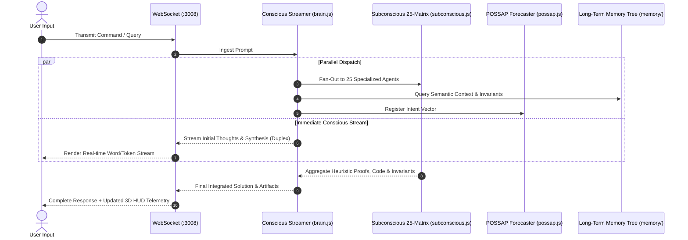

# 01. Architecture Overview

## Neuroscience-Inspired Dual-Layer Cognition

The foundational insight of **SIS 1.0 (Superintelligence System)** is that conventional LLM chat interfaces are purely sequential ("System 1" thinking), whereas true human superintelligence operates through an interplay between a rapid conscious speech/stream generator and a massive, parallel, multi-domain subconscious network ("System 2" thinking).

---

## 1. The Conscious Layer (`server/orchestrator/brain.js`)

- **Role**: Primary real-time communication interface with the user.
- **Mechanism**:
  - Streams tokens at 60 FPS over WebSocket to prevent latency bottlenecks.
  - Employs an **Inner Reviewer** (self-evaluating truthfulness and safety prior to token output) and an **Outer Reviewer** (evaluating synthesis coherence after generation).
  - Automatically coordinates tool execution, workspace file writes, and 3D simulation generation.

---

## 2. The Subconscious Layer (`server/orchestrator/subconscious.js`)

- **Role**: 25 specialized, non-blocking cognitive heuristic parts executed in parallel:
  1. **Logician**: Deductive validity, predicate calculus, and syllogistic verification.
  2. **Mathematician**: Algebraic structures, numerical stability, and LaTeX formal proofs.
  3. **Algorithm Optimizer**: Asymptotic time ($O$) and space ($\Omega$) complexity analysis.
  4. **Security Architect**: Vulnerability surfaces, threat vectors, and defense invariants.
  5. **Physicist**: Kinematics, quantum mechanics, and physical constraints.
  6. **Empiricist**: Evidence synthesis, scientific citations, and falsification criteria.
  7. **Systems Engineer**: Concurrency, cache coherence, and fault tolerance.
  8. **Predictive Forecaster**: Probabilistic future state and ripple effect analysis.
  9. ...and 17 additional domain-specific heuristics.
- **Orchestration**:
  - Tasks are partitioned and dispatched concurrently using asynchronous worker promises.
  - Insights are synthesized into compact heuristic tokens and ingested by the Conscious streamer.

---

## 3. Anticipatory Action (POSSAP)

- **Predictive Opportunity & State Simulation Anticipatory Protocol**:
  - Runs continuous background evaluation of the user's trajectory.
  - Anticipates the next likely prompt (with confidence percentage) and pre-computes candidate code, documentation, or 3D assets before the user finishes typing.

---

## 4. Multi-SIS Isolation (`server/systems/manager.js`)

- Supports creating completely isolated "SIS Instances" with zero-state boundaries:
  - Distinct system names, descriptions, system prompts, memory graphs, and conversational histories.
  - Switched dynamically via the Top Command Bar without restarting backend services.
