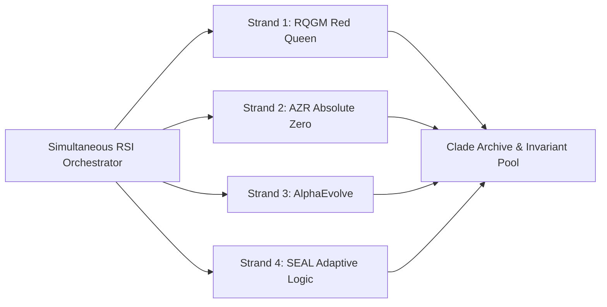

# 06. Recursive Self-Improvement (RSI) & Autonomous Learning

SIS 1.0 features a Level 5 **Recursive Self-Improvement (RSI)** architecture (`server/rsi/`) designed to continuously evolve the system's reasoning capabilities, prompt templates, and algorithmic efficiency without human intervention.

---

## 1. The 4 Simultaneous RSI Strands

Unlike linear fine-tuning pipelines, SIS 1.0 executes four evolutionary strands concurrently through `rsi/simultaneous-orchestrator.js`:

### Strand 1: Red Queen Game Model (`RQGM`)

- **Role**: Adversarial Invariant Stress-Testing.
- **Mechanism**: Spawns paired adversarial sub-agents ("Challenger" vs "Defender"). The Challenger synthesizes complex edge-case failure modes and logic paradoxes; the Defender evolves mathematical invariants to prevent system collapse.

### Strand 2: Absolute Zero Reasoning (`AZR`)

- **Role**: Zero-Entropy Deductive Formalization.
- **Mechanism**: Derives architectural optimizations and algorithms starting strictly from first principles and axioms, proving correctness without relying on ungrounded heuristic priors.

### Strand 3: AlphaEvolve (`AlphaEvolveEngine`)

- **Role**: Genetic Evolutionary Prompt & Code Mutator.
- **Mechanism**: Applies stochastic mutation, crossover, and fitness selection to system prompts and heuristic agent configurations, retaining mutations that yield measurable gains in reasoning benchmarks.

### Strand 4: Self-Evolving Adaptive Logic (`SEAL`)

- **Role**: Meta-Learning & Runtime Policy Synthesis.
- **Mechanism**: Analyzes past conversation histories and tool execution logs to identify inefficiencies, automatically updating routing policies and tool selection heuristics.

---

## 2. Clade Tracking & Historical Lineage (`clade-archive.js`)

- Every successful evolutionary advancement is registered as an immutable "Clade" (phylogenetic lineage).
- Tracks:
  - Generation / Epoch index.
  - Quantitative fitness score gain.
  - Mutated prompt or algorithmic diff.
  - Formal invariant verification proof.
- Can be inspected interactively via the **CLADE INSPECTOR** modal in the Self-Improvement tab.

---

## 3. Autonomous Dataset Mining (`conversation-dataset-miner.js`)

- Periodically scans past session transcripts stored on disk.
- Extracts high-value problem-solution pairs, formatting them into supervised instruction datasets and exemplar banks for future bootstrapping.
