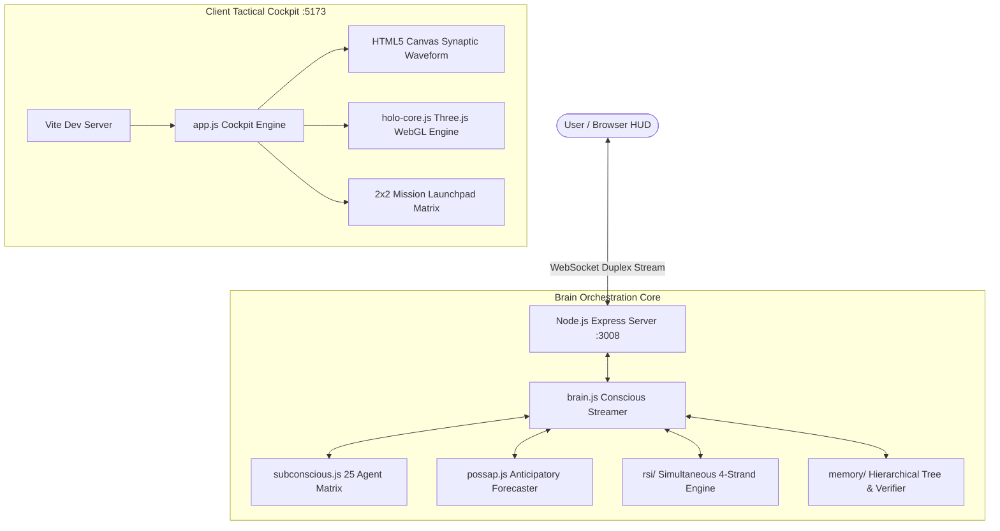

# SIS 1.0 Architecture Wiki

For current entry points, source ownership, and verification commands, see [the workspace map](../docs/WORKSPACE.md). The subsystem articles also describe earlier HUD surfaces.

Welcome to the **SIS 1.0 (Superintelligence System)** Codebase Wiki. This knowledge base provides comprehensive architectural documentation, design patterns, API schemas, and development guidelines for engineers and autonomous AI agents.

---

## 📚 Wiki Table of Contents

| Article                                                            | Description                                                    | Key Modules Covered                                   |
| ------------------------------------------------------------------ | -------------------------------------------------------------- | ----------------------------------------------------- |
| [01. Architecture Overview](01-architecture-overview.md)           | High-level neuroscience-inspired dual-stream design            | `brain.js`, `subconscious.js`, 25-part agent matrix   |
| [02. Frontend HUD System](02-frontend-hud-system.md)               | Sci-fi cockpit UI, live Synaptic Oscilloscope, directives      | `index.html`, `app.js`, `main.css`, `animations.css`  |
| [03. 3D Optical Holo-Core](03-3d-optical-holo-core.md)             | WebGL Three.js engine, UnrealBloomPass, solar loops            | `holo-core.js`, EffectComposer, 25 orbital satellites |
| [04. Backend API & WebSocket](04-backend-api-and-websocket.md)     | Duplex streaming protocol, REST routes, error recovery         | `server/index.js`, WebSocket lifecycle, `/api`        |
| [05. Memory Tree & POSSAP](05-memory-tree-and-possap.md)           | Long-term memory graph, 24/7 verifier, anticipatory AI         | `memory/`, `possap/index.js`, D3.js tree visualizer   |
| [06. RSI & Autonomous Learning](06-rsi-and-autonomous-learning.md) | Level 5 Recursive Self-Improvement 4-strand engine             | `rsi/`, `RQGM`, `AZR`, `AlphaEvolve`, `SEAL`          |
| [07. Token Optimization Guide](07-token-optimization-guide.md)     | Strict protocol for AI agents to operate at minimal token cost | `brain.md`, slicing rules, zero-redundancy recipes    |

---

## 🚀 Quick Reference Commands

```bash
# Start full stack (Express on its printed port, then Vite on 5173)
npm run dev

# Run only backend server
npm run server

# Run only Vite frontend dev server
npm run client

# Compile production bundle into dist/
npm run build
```

---

## 🎯 Architecture Diagram


